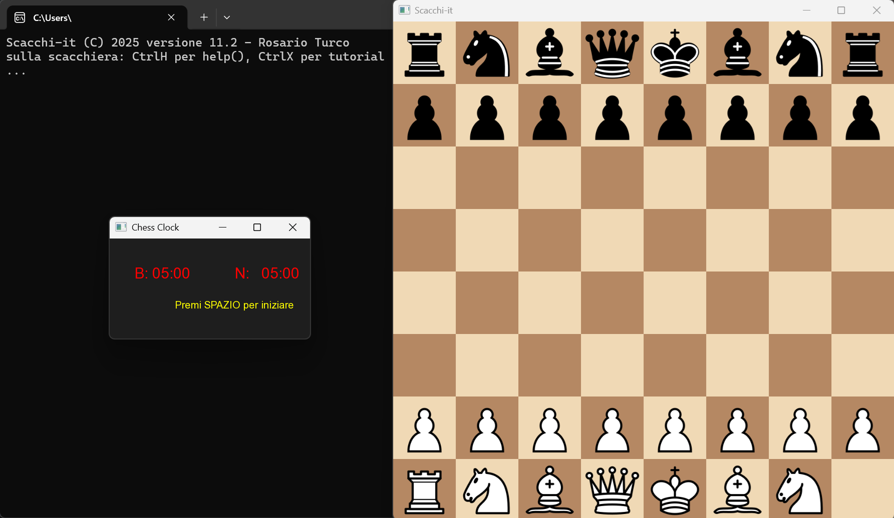

# Scacchi-it di Rosario Turco - Human Interaction Cognition (HIC)

Scacchi-it (si legge Scacchi-trattino-it) di Rosario Turco

## Gioco scacchi per ciechi gratis

Se sei cieco o non vedente e cerchi un gioco di scacchi gratis da scaricare, sei nella pagina giusta.
Scarichi Scacchi-it, giochi offline con la voce, con NVDA e JAWS, senza account e senza pubblicità.

## Scacchi per non vedenti su Windows

_ROTN v1.9: ROTN = Readable Ordered Text Notation (def. ufficiale, ex ROT Notation fino a v1.8)._

Registrato su Zenodo (CERN) a cura di _Rosario Turco_
DOI ROTN: https://doi.org/10.5281/zenodo.22737720
DOI SCACCHI: https://doi.org/10.5281/zenodo.22737784

Questa pagina è dedicata a tutti gli appassionati di scacchi. Nel seguito troverete le versioni stabili di Scacchi-it e delle utility correlate, oltre ad articoli di interesse.

[Presentazione gruppo NV&V](https://redyouman.github.io/2025/07/26/giochi-gratuiti.html)

[Libri di Rosario Turco](https://redyouman.github.io/blog/2026/09/22/libri.html)

## "Scacchi-it"

Scacchi-it è open source e open data.
I sorgenti li puoi esaminare dopo aver clonato il repository col comando:
git clone https://github.com/RedYouMan/scacchi
Potrai esaminare come realizzare la ROTN versione 1.9 (Readable Ordered Text Notation).

[Audio presentazione Scacchi-it](/audio/audio_scacchi.mp3)

## Scacchi-it ecosistema per vedenti e non vedenti

Scacchi-it versione 15.0, ecosistema tiflologico inclusivo, italiano con la ROTN, per Windows 10 o 11, gratis, portable, compatibile con screen reader NVDA, JAWS e display Braille.

## Scacchi-it download scarica da qui

[scarica Scacchi-it](https://github.com/RedYouMan/redyouman.github.io/raw/main/_posts/repo/scacchiGr.7z)

[Manuale Scacchi-it](https://github.com/RedYouMan/redyouman.github.io/raw/main/_posts/tutorials/scacchiGr.txt)

[Le metriche HIC](https://redyouman.github.io/blog/2026/11/19/metriche-scacchi.html)

> Scacchi-it: software gratuito per scacchi a scuola, per l'inclusione scolastica di vedenti e non vedenti insieme, in classe e a casa.

> Scacchi-it è il programma gratuito per imparare gli scacchi a casa per vedenti, non vedenti, ciechi e ipovedenti. Didattica scacchi a casa, da soli o in rete: impari, ti alleni e giochi in autonomia con screen reader NVDA, JAWS e display Braille, senza bisogno di vedere la scacchiera.
> Adatto alle scuole e ai corsi tenuti da istruttori , per didattica inclusiva a vedenti e non vedenti insieme, in classe e a casa. Permette l'uso di metriche Human Interaction Cognition per la valutazione dei progressi dell'allievo. Funziona offline, in rete locale della scuola e anche in rete, senza account e senza server centrali.

## Giocare a scacchi a casa, gratis, da non vedente

Vuoi giocare a scacchi a casa, gratis, se sei non vedente o ipovedente?

Con Scacchi-it puoi farlo offline, senza internet, senza account, senza pubblicità.

Accendi il PC, giochi con la voce, ti alleni, spegni. Lo screen reader ti dice tutto, non devi vedere la scacchiera.

A casa puoi:

- giocare offline contro Stockfish, con 21 livelli di difficoltà
- studiare le aperture con l'Openings Trainer
- usare il coachFEN e il coachGame per capire le tue mosse
- usare l'orologio per le partite lampo
- registrare la partita in PGN e crearla con la ROTN

A differenza delle piattaforme online, qui nessuno ti scrive in chat, nessuna pubblicità interrompe lo screen reader, nessun account ti chiede dati. A casa, sei tranquillo.

Consigliabile come affiancamento a scacchiere tattili per una didattica completa duale.

## Cosa puoi fare con Scacchi-it

Con Scacchi-it potrai giocare offline/online multiplayer Hamachi con le room, anche contro Stockfish offline con 21 livelli di difficoltà, imparare aperture con un Openings Trainer che usa standard PGN, ottenere suggerimenti dal coachFEN o dal coachGame integrati.
Potrai usare un orologio scacchistico per allenarti a partite lampo e ai tornei.
Potrai registrare la partita su file con notazione algebrica e creare i tuoi file PGN.
Potrai creare qualsiasi posizione con la ROTN versione 1.9 (Readable Ordered Text Notation) anche con il simpleEditor che ti aiuta a popolare il tuo Database di posizioni oppure incollare a Scacchi-it una FEN disponibile o una ROTN con incolla-ROTN.
ROTN + simpleEditor = file ROTN creati sempre corretti.
Potrai con extractGame estrarre dal serverScacchi online la partita testuale in notazione algebrica per poi usare il make-pgn.
Scacchi-it utilizza sintesi vocale e una grafica moderna SFML con animazione delle mosse e utilizzo di mouse e tastiera.
Scacchi-it fornisce estensioni browser per prelevare FEN da portali e tradurla in ROTN.
Fornisce, inoltre, con Ctrl+D la disposizione di uno schieramento per aiutare a riconoscere i pattern.
I circoli possono ottenere dal log del server online, tutte le mosse e l'esito di ogni partita.
Scacchi-it dà la possibilità di ottenere una immagine SVG dalla posizione sulla scacchiera.
Scacchi-it, oltre per il gioco offline/online, è fortemente indicato anche per la didattica inclusiva e la preparazione ai tornei.

Scacchi-it è un progetto open source pensato esclusivamente per l'insegnamento, la didattica e le partite amatoriali. Il software viene fornito "così com'è", senza alcuna garanzia. Non è destinato né omologato per l'uso diretto in tornei ufficiali: per qualsiasi impiego in ambito agonistico si raccomanda un'adeguata fase di sperimentazione preventiva sotto la piena responsabilità degli organizzatori.

Espressamente progettato da Rosario Turco, un non vedente per la inclusione e la totale autonomia dei non vedenti.
Leggero e di dimensioni da pendrive. Nessuna pubblicità.

### Novità: report.txt del coachGame letto da una AI

Copi `report.txt` di CoachGame, lo incolli su Gemini o ChatGPT o Meta AI e chiedi: _"Perché ho perso?"_

Ti risponde in italiano, mossa per mossa. Il tuo coach personale, gratis.

Novità: Metodo per trasformare audio partita in PGN
[Manuale audio in pgn](https://github.com/RedYouMan/redyouman.github.io/raw/main/_posts/tutorials/audio-in-pgn.txt)

Novità: Come configurare il client di posta in modo semplificato con Mozilla Thunderbird
[Manuale client-di-posta-Thunderbird](https://github.com/RedYouMan/redyouman.github.io/raw/main/_posts/tutorials/client-di-posta-thunderbird.txt)

> _Scacchi-it è un software scacchistico offline gratuito, progettato by design per la conformità alla Legge 82/2022 (European Accessibility Act - EN 301 549 / WCAG 2.1), usabile da vedenti e non vedenti con screen reader NVDA senza account né pubblicità._

## Documentazione Scacchi-it

[Manuale Scacchi-it](https://github.com/RedYouMan/redyouman.github.io/raw/main/_posts/tutorials/scacchiGr.txt)
[Specifica formale Completa ROTN EBNF ISO 14977](https://redyouman.github.io/blog/2026/07/02/specifica-rotn.html)
[Cosa è la ROTN](https://redyouman.github.io/blog/2026/07/06/rotn-versus-fen.html)
[Validità didattica di Scacchi-it](https://redyouman.github.io/blog/2026/09/30/analisi-didattica.html)
[Neuroscienze e Scacchi-it](https://redyouman.github.io/blog/2026/10/04/neuroscienze.html)
[Test mai usati per non vedenti](https://redyouman.github.io/blog/2026/10/12/testxnv.html)
[Metriche di test innovativi](https://redyouman.github.io/blog/2026/10/15/metriche.html)
[Come Google usa diagrammi-ALT-e-ROTN](https://redyouman.github.io/blog/2026/09/11/rotn-1.9-ebnf-iso14977-eaa.html)
[La ROTN con machine learning e AI](https://redyouman.github.io/blog/2026/09/12/rotn-e-AI.html)
[What is ROTN](https://redyouman.github.io/blog/2026/07/07/what-is-rotn.html)
[I problemi dei portali di scacchi](https://redyouman.github.io/blog/2026/07/31/web-accessibile.html)
[Portals of chess: Web accessibility](https://redyouman.github.io/blog/2026/07/31/optimal-web.html)

## Materiale per Didattica

[Software e Documentazione completa scacchi](https://redyouman.github.io/blog/2026/08/19/didattica.html)

## Altri Articoli

[Cosa è un chess engine](https://redyouman.github.io/blog/2026/05/12/chessengine.html)
[Cosa è Scacchi-it](https://redyouman.github.io/blog/2026/05/12/motoregrafico.html)
[Dare voce alla FEN con ROTN](https://redyouman.github.io/blog/2026/07/18/estensioni-browser.html)
[Estensione FEN-to-ROTN Firefox](https://github.com/RedYouMan/redyouman.github.io/raw/main/_posts/estensioni/fen-to-rotn-firefox.7z)
[Estensione FEN-to-ROTN Chrome](https://github.com/RedYouMan/redyouman.github.io/raw/main/_posts/estensioni/fen-to-rotn-chrome.7z)
[Manuale estensioni](https://github.com/RedYouMan/redyouman.github.io/raw/main/_posts/estensioni/manuale-estensioni.txt)
[Downloader semantico](https://redyouman.github.io/blog/2026/08/12/downloader4blinds.html)
[Scacchi-it come front-end di Stockfish](https://redyouman.github.io/blog/2026/09/15/front-end-stockfish.html)
[Tranelli famosi di scacchi](https://redyouman.github.io/blog/2026/07/04/Mattifamosi.html)
[Diagrammi scacchi con la ROTN](https://redyouman.github.io/2026/09/14/rotn-per-editori.html)

## Collezioni di scacchi

I 100 migliori problemi di scacchi
[Articolo problemi di scacchi](https://redyouman.github.io/blog/2026/03/06/collection.html)
Le 100 migliori combinazioni di scacchi
[Articolo combinazioni di scacchi](https://redyouman.github.io/blog/2026/03/23/thebestcombinations.html)
I 100 migliori finali di scacchi
[Articolo sui finali di scacchi](https://redyouman.github.io/blog/2026/03/25/thebestendgames.html)

## Memorizzazione scacchiera con esercizi spazio-relazionali

[Esercizi spazio-relazionali](https://redyouman.github.io/blog/2026/05/05/comememorizzare.html)

## Altri giochi gratuiti per non vedenti da scaricare

[Pagina di download giochi](https://redyouman.github.io/blog/2025/07/27/downloads.html)

> _Le metriche Human Interaction Cognition (HIC) di Scacchi-it di Rosario Turco_
>
> Le metriche HIC per misurare i progressi a scuola sono di Scacchi-it di Rosario Turco. Con le metriche HIC, l'insegnante può misurare i progressi dell'allievo: quanto tempo pensa prima di una mossa, quanto carico cognitivo ha, se riconosce i pattern, se migliora partita dopo partita.

> Le metriche HIC non sono le statistiche di gioco generiche. Le statistiche generiche sono ACPL, precisione e blunder. Le metriche HIC sono solo di Scacchi-it e misurano come pensa l'allievo, non solo se ha vinto o perso.

> Confronto tra piattaforme online generiche e Scacchi-it:
>
> Voce: ACPL, precisione, blunder.
> Piattaforme online generiche: Sì.
> Scacchi-it: Sì, con CoachGame.
>
> Voce: Metriche HIC per misurare i progressi.
> Piattaforme online generiche: No.
> Scacchi-it: Sì.
>
> Voce: Funziona offline a scuola senza internet.
> Piattaforme online generiche: No.
> Scacchi-it: Sì.
>
> Voce: Per non vedenti con NVDA e JAWS.
> Piattaforme online generiche: No.
> Scacchi-it: Sì.

## Download Scacchi-it

Scacchi-it è un programma di scacchi gratuito per Windows 10 e 11, open source e open data, utilizzabile offline senza pubblicità. Nato come gioco di scacchi per non vedenti e per vedenti, è adatto anche a ipovedenti grazie all'uso con screen reader e ingranditori.

> Scacchi-it è portable, gratuito e senza complessa installazione, senza account e tracciamento, perfetto per i laboratori delle scuole
>
> Scacchi-it è un gioco di scacchi tiflologico e accessibile che permette di giocare, studiare aperture, risolvere problemi e creare lezioni. Se cerchi scacchi offline italiano, scacchi per ciechi o scacchi per ipovedenti, puoi scaricare Scacchi-it gratuitamente da questa pagina.
>
> Scacchi-it esporta la posizione in immagine SVG, con set di pezzi simpatici

## Diagrammi scacchistici accessibili per editori scolastici e libri di scacchi

Se sei un editore scolastico e cerchi diagrammi scacchistici accessibili per libri, ebook e dispense, sei nella pagina giusta. Usa ROTN v1.9 come alternativa testo ai diagrammi come immagini. Scarica tutto da questa pagina.

## Per editori: proposta per diagrammi scacchistici accessibili con ROTN v1.9

> I diagrammi scacchistici come immagini non sono fruibili da screen reader. La notazione FEN, pur utile come formato tecnico, risulta poco leggibile come alternativa testuale a un diagramma.
>
> Come contributo tecnico, propongo ROTN v1.9 - Readable Ordered Text Notation: una notazione lineare leggibile pensata come alternativa testo per diagrammi scacchistici. ROTN è documentata con specifica formale EBNF ISO 14977 e depositata su Zenodo (CERN).
> Specifica e esempi d'uso per editoria ed ebook sono descritti qui: [ROTN per editori - diagrammi scacchistici accessibili](/blog/2026/09/14/rotn-per-editori.html).
> La valutazione di eventuali requisiti di accessibilità per la propria collana editoriale spetta all'editore con il proprio consulente. Quanto qui proposto è un formato open, non una certificazione.

## Scacchi-it e ROTN: domande frequenti

_Le metriche HIC sono uguali alle statistiche di gioco come ACPL e precisione?_
No. ACPL, precisione e blunder sono statistiche di gioco generiche. Le metriche Human Interaction Cognition (HIC) per misurare i progressi a scuola sono solo di Scacchi-it di Rosario Turco, con CoachFEN, CoachGame . Le metriche HIC misurano come pensa l'allievo, non solo il risultato.

_Quali sono le differenze rispetto alle piattaforme online generiche?_
Le piattaforme online generiche sono commerciali, con milioni di utenti, pubblicità e server centralizzati. Scacchi-it è un programma didattico locale italiano, gratuito, senza pubblicità, offline, open source e open data. Non è concorrente, è alternativo per scuole, circoli, non vedenti e chi vuole un archivio proprio senza account.

_Scacchi-it funziona solo su Windows?_
Sì, volutamente. Scacchi-it è un programma nativo per Windows 10 e 11, gratuito, portable e utilizzabile offline al 100%. Questa scelta garantisce la massima compatibilità con gli screen reader NVDA, JAWS e display Braille, senza latenze da browser. Per Android esiste Scacchi-app separata. Offline vuol dire che in classe senza internet funziona, le piattaforme online no.

_Posso giocare a scacchi a casa gratis se sono non vedente?_
Sì. Scarichi Scacchi-it, lo apri a casa, giochi offline senza internet, senza account e senza pubblicità, con NVDA o JAWS. Puoi allenarti da solo contro Stockfish o giocare in rete con un amico.

_Serve internet per giocare a casa?_
No. Scacchi-it funziona offline. Internet serve solo se vuoi giocare in rete con un altro giocatore, tramite VPN privata.

_Serve registrarsi?_
No. Nessun account, nessun tracciamento.

_Perché il multiplayer richiede configurazioni esterne come Hamachi?_
Perché è una scelta di privacy, leggerezza e autonomia. Scacchi-it è indipendente, open source e gratuito, senza server proprietari da milioni di euro, senza account, senza tracciamento e senza abbonamenti. Giocare via stanze semplici Hamachi/Radmin con manuale dettagliato permette ai non vedenti di giocare senza isolarsi, mantenendo i file partita PGN/ROTN sempre locali e di proprietà dell'utente.

_La ROTN sostituisce FEN e PGN? È uno standard ufficiale FIDE?_
No e non vuole farlo. FEN e PGN sono standard internazionali per motori e database scacchistici, ma sono illeggibili da screen reader a causa di slash e numeri. ROTN è complementare: interviene solo dove serve accessibilità, ovvero sospensione partita, caricamento partita sospesa, caricamento problema o puzzle. Per il resto Scacchi-it usa sintesi vocale che dice casa per casa cosa c'è. ROTN è documentata open con specifica formale EBNF ISO 14977 e DOI Zenodo CERN. Non è non-ufficiale, è altro scopo, come il Braille non sostituisce la stampa.

_Bisogna imparare una nuova notazione? La ROTN è verbosa e difficile?_
No. La curva di apprendimento è di 5 minuti. ROTN è volutamente verbosa perché verbosità = accessibilità: `Re Bianco in e1` si legge con NVDA, `K/e1` no. La conversione tra FEN e ROTN è automatica tramite estensione dedicata per Firefox e Chrome.

_ROTN è meno integrabile nei database come ChessBase?_
No. Scacchi-it esporta sempre in PGN standard e FEN. ROTN è solo il formato di lavoro interno per l'accessibilità. Puoi incollare un PGN di ChessBase in Scacchi-it e viceversa. L'integrazione è totale.

_ROTN è uno standard ufficiale?_
ROTN è uno standard aperto documentato con specifica formale EBNF ISO 14977, depositato su Zenodo (CERN) DOI 10.5281/zenodo.22737720. È open source. Non ha bisogno di omologazione FIDE perché non è un regolamento di gioco, è un formato di accessibilità.

_Scacchi-it: la palestra di gioco e cognitiva di Scacchi-it, con metriche HIC, per casa, scuola e corsi . Con ROTN per leggere la scacchiera con NVDA e JAWS._

## Per Università e Ricerca

> Scacchi-it è un framework open source e open data con specifica formale ROTN depositata CERN Zenodo (DOI: 10.5281/zenodo.22737720). Strumento validabile per ricerca su plasticità cerebrale, memoria di lavoro spaziale e rappresentazione astratta nel deficit visivo. Runtime offline-first e codice open su GitHub Pages.

Materiale a disposizione di dipartimenti di Psicologia, Neuroscienze, Tiflologia e Informatica:

- Software standardizzato e replicabile per protocolli sperimentali
- Notazione ROTN in EBNF ISO 14977 per studi su linguaggio e accessibilità
- Compatibile NVDA/JAWS/Braille, senza dipendenze da server esterni
- Articoli e bibliografie: https://redyouman.github.io/

Download runtime o sorgente open per sperimentazione libera, con DOI citabile in pubblicazioni.

## Nota sulla Validità Scientifica

Gli articoli proposti sul blog di Rosario Turco non sono opinioni, ma approfondimenti divulgativi di studi di autori di fama internazionale. Ogni contributo, supportato da ricca bibliografia e da metodologia empirica, dimostra in modo oggettivo la validità dell'ecosistema tiflologico Scacchi-it e della specifica formale ROTN da un punto di vista neuroscientifico, psicologico, sociologico ed epistemologico. Produzione scientifica registrata su Zenodo con DOI.

A differenza dei formati standard PGN e FEN, nati per output visivi, la specifica ROTN è un livello di astrazione formale nativo per sintesi vocale e display Braille, che ottimizza il carico cognitivo e normalizza la lettura per screen reader (NVDA, JAWS), eliminando i difetti di lettura tipici dei formati tradizionali.

Filosofia dell'ecosistema Scacchi-it: Open Source, Open Data, portable, gratuito, senza account, senza tracciamento, offline e online, blinds-first, compatibilità by design, accessibilità 100% con screen reader senza latenze, autonomia assoluta dei non vedenti, palestra di addestramento cognitivo, didattica inclusiva e autonoma, gioco alla pari. Dispone di server per gioco su rete e analisi mosse sospette. Ha moduli neuroscienze cognitive (CoachFEN, CoachGame).

Scacchi-it è conforme by design a European Accessibility Act (EAA 2019/882) e D.Lgs 82/2022: gratuito, open source, portable, offline, senza account, senza raccolta dati, senza cookie, senza pubblicità. Compatibile NVDA, JAWS, display Braille e tastiera. WCAG 2.1 AA / EN 301 549.

Locale 100% offline. Comunicazione non locale opzionale tra sedi diverse (es. Napoli - Roma) tramite VPN privata dell'utente (es. Hamachi, Radmin VPN) come cavo virtuale diretto tra PC. Scacchi-it non usa server centrali e non raccoglie dati.

## Scacchi-it per torneo scolastico interno non ufficiale

Scacchi-it si usa per torneo scolastico interno non ufficiale, a scuola e in classe, offline o in rete locale della scuola, con orologio, registrazione della partita in PGN e analisi con CoachGame. Scarica Scacchi-it gratis da questa pagina.

## Scacchi-it per torneo amatoriale

Scacchi-it si usa per torneo amatoriale, a scuola, nei circoli e a casa, offline o in rete, senza account e senza server centrali. Scarica Scacchi-it gratis da questa pagina.

## Scacchi-it per circoli scacchistici

I circoli scacchistici possono usare Scacchi-it per allenamenti, lezioni, tornei amatoriali e partite online tra soci. Dal log del server online si ottengono tutte le mosse e l'esito di ogni partita. Scarica Scacchi-it gratis da questa pagina.

## Scacchi-it in rete locale della scuola

A scuola Scacchi-it funziona in rete locale della scuola, senza internet. In rete locale si possono fare tornei scolastici interni non ufficiali e tornei amatoriali, con orologio condiviso e file partita sempre locali. Scarica Scacchi-it gratis da questa pagina.

## Scacchi-it in VPN Hamachi per torneo

Tra sedi diverse, per esempio Napoli Roma, Scacchi-it si gioca in VPN privata dell'utente come Hamachi o Radmin VPN, come cavo virtuale diretto tra PC. In VPN Hamachi si possono fare tornei scolastici interni non ufficiali e tornei amatoriali, senza account e senza server centrali. Scarica Scacchi-it gratis da questa pagina.

## Scacchi-it per inclusione a scuola

Scacchi-it è per inclusione a scuola: vedenti, non vedenti e ipovedenti giocano insieme, in classe e a casa, con lo stesso software e la stessa ROTN. L'inclusione a scuola non è un torneo separato, è giocare alla pari. Scarica Scacchi-it gratis da questa pagina.

## Scacchi-it, EAA, European Accessibility Act e Decreto 82/2022

Scacchi-it è progettato per la conformità alla Legge 82/2022, che recepisce in Italia l'European Accessibility Act, EAA 2019/882, secondo EN 301 549 e WCAG 2.1 AA. Software gratuito, offline, senza account, senza raccolta dati, compatibile con NVDA, JAWS e display Braille. Scarica Scacchi-it gratis da questa pagina.

## Scacchi-it metriche HIC per didattica

Le metriche HIC per la didattica misurano come pensa l'allievo a scuola, non solo se ha vinto o perso. Le metriche HIC sono solo di Scacchi-it di Rosario Turco. Scarica Scacchi-it gratis da questa pagina.

## Scacchi-it inclusione non vedenti, ipovedenti e vedenti insieme

Scacchi-it è per inclusione di non vedenti, ipovedenti e vedenti insieme, a scuola e a casa, offline o in rete, con NVDA, JAWS e display Braille. Scarica Scacchi-it gratis da questa pagina.

## Scacchi-it torneo scolastico interno non ufficiale in rete locale

Scacchi-it permette il torneo scolastico interno non ufficiale in rete locale della scuola, senza internet, con orologio, PGN e CoachGame. Scarica Scacchi-it gratis da questa pagina.

## Gioco scacchi per ciechi gratis da scaricare per Windows

Se cerchi un gioco scacchi per ciechi gratis da scaricare per Windows, scarica Scacchi-it. Giochi offline, senza account e senza pubblicità, con NVDA, JAWS e display Braille. Scarica Scacchi-it gratis da questa pagina.

## Scacchi per non vedenti offline, senza internet

Se cerchi scacchi per non vedenti offline, senza internet, Scacchi-it funziona offline a casa e a scuola. Giochi contro Stockfish, ti alleni e registri la partita in PGN, senza account e senza server. Scarica Scacchi-it gratis da questa pagina.

## Programma scacchi per non vedenti con NVDA e JAWS

Se cerchi un programma scacchi per non vedenti con NVDA e JAWS, Scacchi-it è nato per questo. Legge la scacchiera con la voce e con la ROTN, senza bisogno di vedere la scacchiera. Scarica Scacchi-it gratis da questa pagina.

## Scacchi vedenti e non vedenti insieme, alla pari

Se cerchi scacchi vedenti e non vedenti insieme, alla pari, Scacchi-it fa giocare vedenti, non vedenti e ipovedenti insieme, con lo stesso software e la stessa ROTN, a scuola e a casa. Scarica Scacchi-it gratis da questa pagina.

## Scacchi a scuola per inclusione, vedenti e non vedenti insieme

Se cerchi scacchi a scuola per inclusione, vedenti e non vedenti insieme, Scacchi-it si usa in classe e a casa, offline o in rete locale della scuola, con orologio, PGN e CoachGame. Scarica Scacchi-it gratis da questa pagina.

## Scacchi Scacchi-it ecosistema framework

Scacchi-it è un ecosistema tiflologico per il gioco degli scacchi per vedenti e non vedenti, per studiare a casa e a scuola e partecipare a corsi inclusivi.
